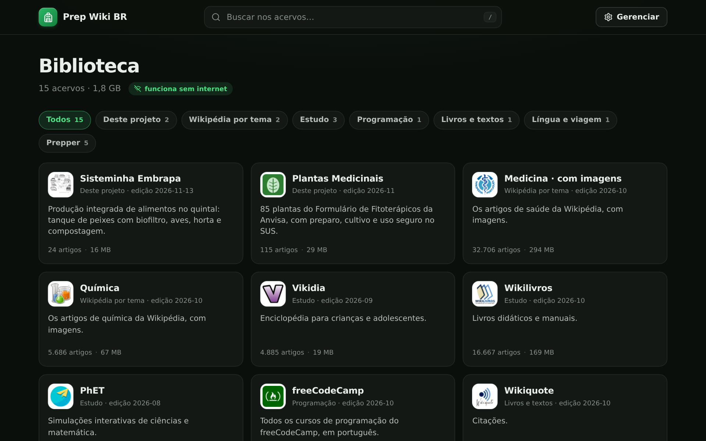
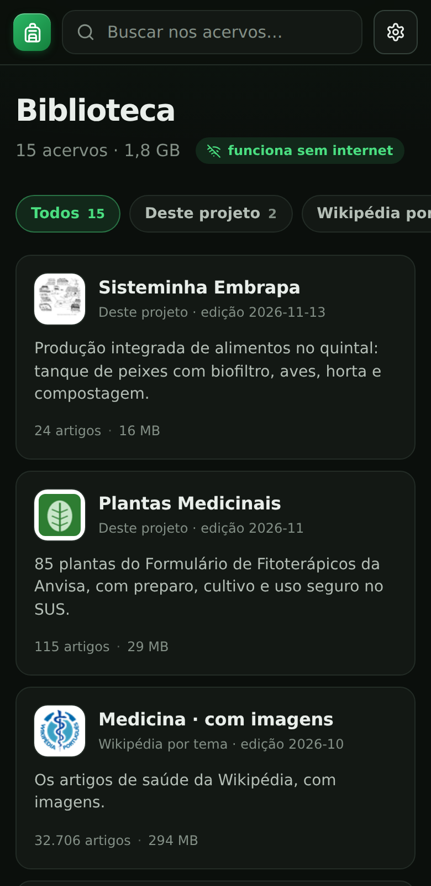
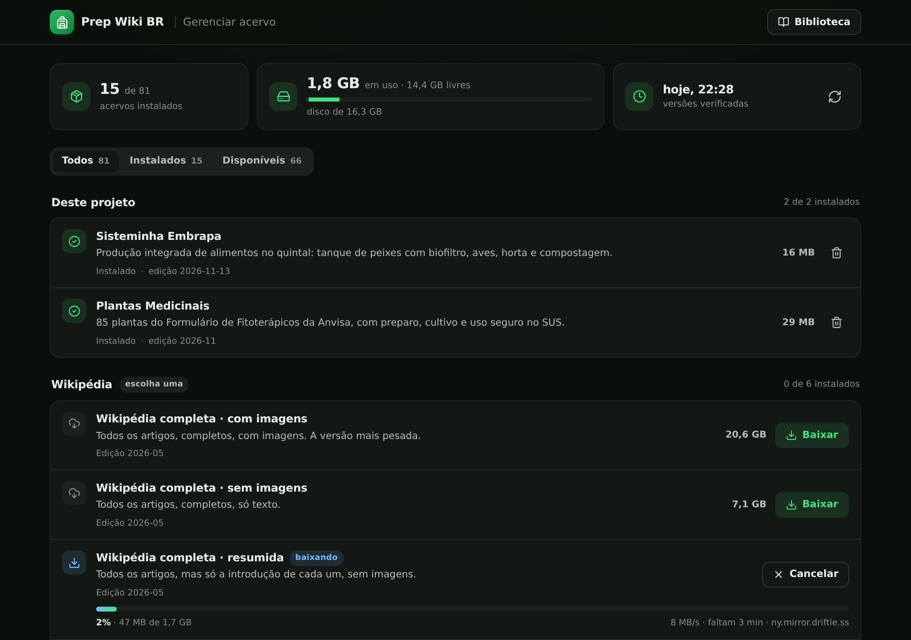
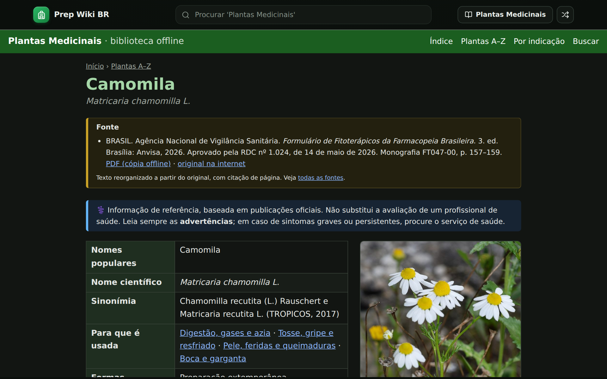

# Prep Wiki BR

**Uma biblioteca de preparação, autonomia e saúde que funciona sem internet, em português.**

Quando a rede cai, numa enchente, num apagão, no sítio ou na estrada, o que você precisa saber tem que estar na sua máquina. O Prep Wiki BR é uma biblioteca offline que você instala num computador, num mini PC ou num Raspberry Pi e acessa pelo navegador de qualquer aparelho da casa. Você escolhe o que baixar numa lista pronta de 81 acervos, e depois tudo funciona sem internet.



**Neste README:**
[O que é](#o-que-é) ·
[O que tem](#o-que-tem) ([em português](#em-português), [Prepper em inglês](#prepper-em-inglês)) ·
[Como instalar](#como-instalar) ·
[As duas wikis do projeto](#as-duas-wikis-do-projeto) ·
[Para quem quer mexer](#para-quem-quer-mexer) ·
[Licenças](#licenças) ·
[Agradecimentos](#agradecimentos)

## O que é



São três partes, servidas numa porta só:

- **Biblioteca:** a página inicial, com os acervos instalados, filtro por categoria e busca dentro do texto de todos eles.
- **Gerenciador:** a lista de acervos disponíveis. Você baixa, atualiza e apaga com um clique. Ele mostra o tamanho de cada um e o espaço livre em disco.
- **Leitor:** cada acervo abre como um site, com busca própria e artigo aleatório.

O projeto também produz **duas wikis próprias**, reescritas a partir de publicações oficiais brasileiras: [Sisteminha Embrapa](#sisteminha-embrapa) e [Plantas Medicinais](#plantas-medicinais).

Para conferir o conteúdo antes de instalar, o acervo em português está no ar em **[prep.bigode.org](https://prep.bigode.org/#lang=por)**. Esse endereço ainda mostra a interface padrão do Kiwix, não a das imagens deste README.

<br clear="right">

| Gerenciador | Leitor |
|---|---|
|  |  |

## O que tem

São 81 acervos no catálogo, em novembro de 2026. Você instala só os que quiser. Os tamanhos mudam um pouco a cada edição.

### Em português

| Grupo | Acervos | Tamanho |
|---|---|---|
| **Deste projeto** | [Sisteminha Embrapa](#sisteminha-embrapa) e [Plantas Medicinais](#plantas-medicinais) | 45 MB |
| **Wikipédia** (escolha uma) | Completa com imagens (20,6 GB), sem imagens (7,1 GB) ou resumida (1,7 GB). Só os 50 mil melhores artigos: com imagens (3,0 GB), sem imagens (1,1 GB) ou resumida (153 MB) | 153 MB a 20,6 GB |
| **Wikipédia por tema** | Medicina, Química, Física, Matemática, Biologia molecular e celular, História, Geografia, Computação | 1,8 GB |
| **Estudo** | Vikidia (enciclopédia para crianças), Wikilivros, Wikiversidade, PhET (simulações de ciências) | 371 MB |
| **Consertos** | iFixit | 3,6 GB |
| **Programação** | Stack Overflow em Português, freeCodeCamp | 945 MB |
| **Livros e textos** | Wikisource, Projeto Gutenberg, Wikiquote | 2,3 GB |
| **Língua e viagem** | Wikcionário, Portuguese Language Q&A, Wikivoyage | 448 MB |
| **Mapas** | Brasil (3,1 GB) e América do Sul (5,5 GB), com estradas e pontos de referência. A interface do mapa é em inglês | 8,6 GB |

Um conjunto enxuto em português (as duas wikis, a Wikipédia dos 50 mil melhores com imagens, Medicina, iFixit, Estudo e Língua e viagem) fica em torno de 8 GB.

### Prepper, em inglês

Material de preparação que não existe em português, ou que é melhor no original. São 49 acervos.

| Tema | Acervos | Tamanho |
|---|---|---|
| **Preparação e sobrevivência** | Post Disaster Resource Library, Ready.gov, True Prepper, manuais do Exército dos EUA, A Library of Knots, Nós (Wikipédia), The Great Outdoors Q&A, Amateur Radio Q&A, Rabbit Waves | 12,7 GB |
| | Survivor Library: livros sobre como viver quando a tecnologia falha | 220 GB |
| **Água, comida e horta** | Water Treatment Library, Food for Preppers, guia de conservas caseiras do USDA, Gardening Q&A, Gardenology, Seasoned Advice Q&A, Grim Grains, Based Cooking, Sustainable Living Q&A | 1,5 GB |
| **Saúde** | Medical Library (medicina de campo), MDWiki, Medicina (Wikipédia), MedlinePlus, remédios de A a Z do NHS, saúde do viajante do CDC, Military Medicine, Surviving Residency, WikiVet | 7,0 GB |
| **Energia e baixa tecnologia** | Low-tech Magazine, Hundred Rabbits, Appropedia, energypedia, CD3WD, Permacomputing | 2,8 GB |
| **Consertos e habilidades** | iFixit em inglês, Restarters, e perguntas e respostas sobre casa, mecânica, eletrônica, marcenaria e bicicleta | 10,9 GB |
| **Vídeos** | Learning Self-Reliance, Urban Prepper, Canadian Prepper (4 playlists), S2 Underground | 19,0 GB |
| **Referência** | CIA World Factbook (edição de 2020) | 407 MB |

A lista completa, com a descrição de cada acervo, está em [`manager/catalogo.json`](manager/catalogo.json) e aparece no gerenciador.

## Como instalar

Precisa só do [Docker](https://docs.docker.com/engine/install/) e de espaço em disco para o que você for baixar. A imagem existe para PC (x86 de 64 bits) e para ARM de 64 bits, como o Raspberry Pi 4 e 5. Foi testada em PC com Linux; no Raspberry Pi ainda não.

```bash
docker run -d --name prep-wiki-br --restart unless-stopped \
  -p 8099:8080 -v ~/prep-wiki-br:/data ghcr.io/wdonega/prep-wiki-br:latest
```

Abra **http://localhost:8099** (ou `http://<ip-da-máquina>:8099` de outro aparelho da rede). Na primeira vez a biblioteca está vazia e você cai direto no gerenciador:

1. Escolha os acervos e clique em **Baixar**. Os downloads vão para uma fila, um de cada vez.
2. Cada acervo aparece na biblioteca assim que termina, sem reiniciar nada.
3. Para voltar ao gerenciador depois, use o botão **Gerenciar** no topo.

O que vale saber:

- **Onde ficam os arquivos:** na pasta que você indicou no `-v` (no exemplo, `~/prep-wiki-br`). Se ela não existir, é criada. Para usar outro disco, troque o caminho.
- **Sem root:** o container usa o root só no instante da partida, para criar a pasta e acertar o dono dela. Daí em diante o gerenciador e o Kiwix rodam como usuário comum. Os arquivos ficam com o usuário 1000, o primeiro usuário comum da maioria das máquinas; para outro, acrescente `-e PREP_UID=... -e PREP_GID=...`. Se a pasta já existe e é sua, ele usa o seu usuário.
- **Porta:** troque o `8099` do `-p` pela que preferir.
- **Downloads:** vêm dos mirrors oficiais do Kiwix e das releases deste repositório. Se um mirror cai, o gerenciador troca para o próximo e continua de onde parou. Cada arquivo é conferido por sha-256 antes de entrar na biblioteca.
- **Acervos seus:** no fim do gerenciador dá para acrescentar qualquer arquivo `.zim` que não esteja na lista, colando o link ou enviando o arquivo do seu aparelho. O link é conferido antes de baixar. Um `.zim` copiado direto para a pasta também entra, depois de reiniciar o container.
- **Atualizações dos acervos:** quando sai uma edição nova de um acervo instalado, o gerenciador mostra **Atualizar**.
- **Senha do gerenciador:** acrescente `-e PREP_SENHA=sua-senha` ao `docker run` e o gerenciador passa a pedir a senha (o navegador fica lembrado por 30 dias; o botão **Sair** desconecta). A biblioteca e a leitura continuam abertas para todo mundo. Sem `PREP_SENHA`, qualquer pessoa na mesma rede consegue baixar e apagar acervos. Para abrir na internet, use a senha e acesse por HTTPS (um proxy ou um túnel na frente), senão a senha passa aberta pela rede.
- **Versões da imagem:** `:latest` é sempre a mais recente. Cada versão também tem uma tag fixa no formato `AAAA-MM-DD-rN` (por exemplo `:2026-11-13-r2`), listada nas [releases](https://github.com/wdonega/prep-wiki-br/releases?q=imagem&expanded=true). Para ficar numa versão específica, troque `latest` por ela. A versão em uso aparece no rodapé do gerenciador.
- **Instalar numa máquina sem internet:** cada [release da imagem](https://github.com/wdonega/prep-wiki-br/releases?q=imagem&expanded=true) traz a imagem em arquivo (`.tar.gz`, ~30 MB), um para PC (`amd64`) e um para ARM (`arm64`). Leve o arquivo para a máquina, rode `docker load -i <arquivo>` e depois o `docker run` de cima.
- **Atualizar o Prep Wiki BR:** `docker pull ghcr.io/wdonega/prep-wiki-br:latest`, depois `docker rm -f prep-wiki-br` e o mesmo `docker run` de cima. Os acervos baixados continuam na pasta.

<details>
<summary><b>Com Docker Compose, a partir do código</b></summary>

Para quem quer mexer no projeto ou prefere um container mais trancado (sistema de arquivos só leitura, sem privilégios, sem root nem na partida):

```bash
git clone https://github.com/wdonega/prep-wiki-br.git
cd prep-wiki-br/manager
docker compose up -d --build
```

Os acervos ficam em `manager/dados/`. Porta, pasta, usuário e senha mudam num arquivo `manager/.env`, com `PREP_PORTA`, `PREP_PASTA`, `PREP_UID`, `PREP_GID` e `PREP_SENHA`. Se o seu usuário não for o 1000 (veja com `id -u`), ajuste os dois últimos. Para atualizar: `git pull` e `docker compose up -d --build`.

</details>

## As duas wikis do projeto

Cada uma é um arquivo `.zim` gerado a partir de publicações oficiais, com o texto reorganizado para leitura, busca, índice e citação da página de origem. Os PDFs originais vão junto dentro do arquivo.

Elas já vêm no catálogo do Prep Wiki BR, mas não dependem dele: o arquivo abre em qualquer Kiwix, seja o aplicativo de celular, o [Kiwix Desktop](https://kiwix.org/pt-br/applications/) ou um `kiwix-serve`. É só baixar e abrir.

| | O que tem | Ver online | Baixar |
|---|---|---|---|
| <a id="sisteminha-embrapa"></a>**[Sisteminha Embrapa](sisteminha-embrapa)** | Produção integrada de alimentos para a agricultura familiar: tanque de peixes com biofiltro, aves, horta e compostagem. Com figuras, as 52 perguntas e respostas da Embrapa e uma calculadora de ração. | [prep.bigode.org](https://prep.bigode.org/content/sisteminha-embrapa_pt/index) | [sisteminha-embrapa_pt.zim](https://github.com/wdonega/prep-wiki-br/releases/download/sisteminha-embrapa-latest/sisteminha-embrapa_pt.zim) (16 MB)<br><sub>[sha256](https://github.com/wdonega/prep-wiki-br/releases/download/sisteminha-embrapa-latest/sisteminha-embrapa_pt.zim.sha256) · [versões anteriores](https://github.com/wdonega/prep-wiki-br/releases?q=sisteminha-embrapa&expanded=true)</sub> |
| <a id="plantas-medicinais"></a>**[Plantas Medicinais](plantas-medicinais)** | 85 plantas do Formulário de Fitoterápicos da Anvisa (fórmula, preparo, dose, advertências e foto), com seções de preparo caseiro, cultivo e uso seguro no SUS. | [prep.bigode.org](https://prep.bigode.org/content/plantas-medicinais_pt/index) | [plantas-medicinais_pt.zim](https://github.com/wdonega/prep-wiki-br/releases/download/plantas-medicinais-latest/plantas-medicinais_pt.zim) (29 MB)<br><sub>[sha256](https://github.com/wdonega/prep-wiki-br/releases/download/plantas-medicinais-latest/plantas-medicinais_pt.zim.sha256) · [versões anteriores](https://github.com/wdonega/prep-wiki-br/releases?q=plantas-medicinais&expanded=true)</sub> |

O link de download é fixo e aponta sempre para a versão mais recente. Os acervos de saúde são educativos e **não substituem um profissional de saúde**.

## Para quem quer mexer

```
manager/              o Prep Wiki BR: gerenciador em Go, páginas e catálogo
  catalogo.json       a lista de acervos (o que existe, em que grupo, com que descrição)
  web/                página inicial, gerenciador e o estilo aplicado ao leitor
sisteminha-embrapa/   fonte da wiki do Sisteminha (textos, figuras, build.py)
plantas-medicinais/   fonte da wiki de Plantas Medicinais
```

- **Acrescentar um acervo ao catálogo:** inclua uma linha em `manager/catalogo.json` com o nome do arquivo no Kiwix (sem a data), a pasta em que ele fica em `download.kiwix.org/zim/`, o grupo, o título e a descrição. A edição mais recente é descoberta sozinha.
- **Gerar uma das wikis na sua máquina:**
  ```bash
  python3 -m venv venv && venv/bin/pip install -r requirements.txt
  cd plantas-medicinais && ../venv/bin/python build.py
  ```
- **Imagem Docker:** um push na `main` que mexe em `manager/` roda o workflow [`imagem.yml`](.github/workflows/imagem.yml), que monta a imagem para `amd64` e `arm64`, publica em `ghcr.io/wdonega/prep-wiki-br` com as tags `AAAA-MM-DD-rN` e `latest`, e cria uma release `imagem-AAAA-MM-DD-rN`.
- **Releases das wikis:** cada wiki tem um workflow no GitHub Actions. Um push na `main` que mexe na pasta dela gera o ZIM de novo e publica uma release com tag `<pasta>-AAAA-MM-DD-rN`. A release `<pasta>-latest` também é atualizada, e é ela que mantém o link fixo.
- **Criar uma wiki nova:** uma pasta com um `build.py` que gere um `*.zim`, mais uma cópia de `.github/workflows/plantas-medicinais.yml` com o nome da pasta trocado.

Ideias para as próximas wikis, todas a partir de material de órgãos públicos:

- **Embrapa** ([Infoteca-e](https://www.infoteca.cnptia.embrapa.br/)): cisternas, conservação de alimentos, pequenos animais, horta e biodigestor.
- **Defesa Civil:** cartilhas de enchente, deslizamento, seca e kit de emergência.
- **Ministério da Saúde** ([BVS](https://bvsms.saude.gov.br/)): primeiros socorros, tratamento de água e doenças de veiculação hídrica.
- **ASA Brasil:** cisterna de placas e convivência com o semiárido.

## Licenças

- O **código** deste repositório (gerenciador, scripts de build, CSS e JS) pode ser usado livremente.
- O **conteúdo das duas wikis** vem de publicações públicas da Embrapa, da Anvisa e do Ministério da Saúde, reorganizadas para uso **pessoal e educativo, sem fins comerciais**. Toda página cita a fonte. Os créditos completos estão no README de cada wiki e dentro de cada ZIM.
- As **fotos** da wiki de plantas vêm do Wikimedia Commons, com licenças livres, e o autor é creditado em cada imagem.
- Os **outros acervos** não são deste projeto. Cada um segue a licença da sua origem (os da Wikimedia, por exemplo, são CC BY-SA). Alguns, como o iFixit, não permitem uso comercial.

## Agradecimentos

O Prep Wiki BR é um projeto independente, sem relação oficial com nenhum dos nomes abaixo. Ele só existe porque esse trabalho todo é público.

- **[Kiwix](https://kiwix.org/) e [openZIM](https://openzim.org/):** o formato ZIM, o `kiwix-serve` que roda por baixo do leitor, os aplicativos de celular e computador, os mirrors de download e a maior parte dos acervos do catálogo, que eles empacotam e mantêm atualizados.
- **Wikimedia e seus voluntários:** Wikipédia, Wikcionário, Wikilivros, Wikiversidade, Wikisource, Wikiquote, Wikivoyage e o Wikimedia Commons, de onde vêm as fotos das plantas.
- **Embrapa, Anvisa e Ministério da Saúde:** as publicações que deram origem às duas wikis do projeto.
- **Quem produz os outros acervos do catálogo:** iFixit, Stack Exchange, PhET, Vikidia, Projeto Gutenberg, freeCodeCamp, OpenStreetMap, Low-tech Magazine, Hundred Rabbits, Appropedia, energypedia, CD3WD, Survivor Library, MDWiki e WikiProjectMed, MedlinePlus, NHS, CDC, WikiVet, Ready.gov, e os canais e sites de preparação listados no gerenciador.
- **[Lucide](https://lucide.dev/):** os ícones da interface.
